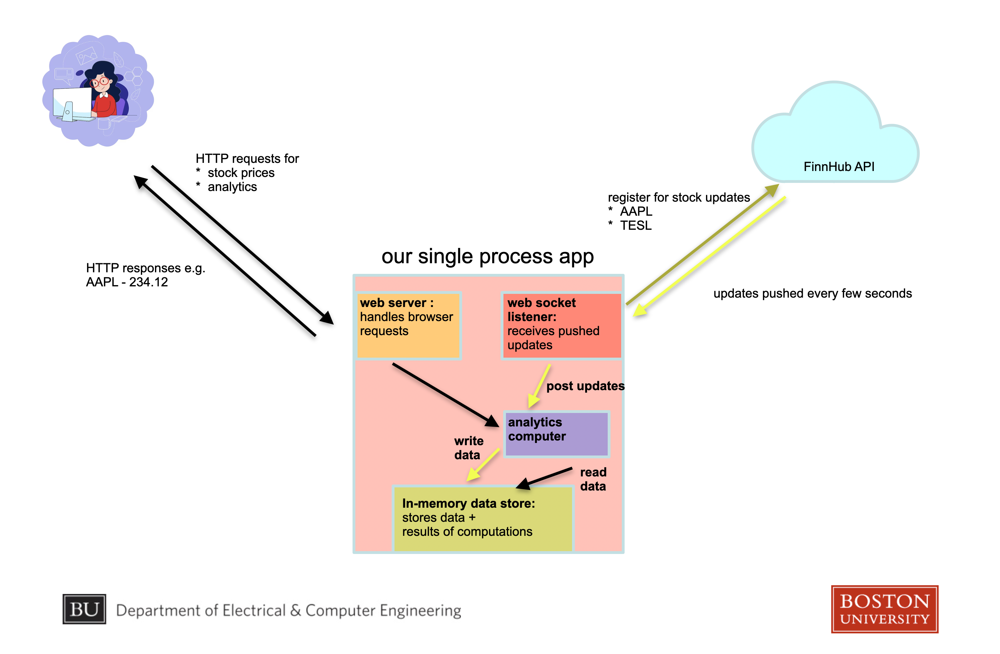

# StockApp

> **EC427 students:** the course syllabus — grading, policies, the oral examinations, and the AI/LLM policy — lives in **[SYLLABUS.md](SYLLABUS.md)**. Homework assignments are in **[hw/](hw/)**. Start there.

A high level overview of the StockApp application is below:



It consists of the following components:


## WebSocket Listener - Finhub API

The data input to StockApp is the [Finhub API](https://finnhub.io/).  More specifically, StockApp supports [WebSocket](https://ably.com/topic/websockets) subscriptions for price & trade volume updates for a set of stock symbols.  These updates are the core source of data for StockApp.

## Analytics Computor

The responsibility of the analytics computor is to take the data that StockApp has received from Finhub and based on this data expose meaningful, actionable information back to StockApps's end users.  For example, the analytics computor is responsible for computing the numeric responses to questions like:

* what is the current price of <symbol>?
* of the symbols being tracked, which one has experienced the highest price fluctuation over the last 3 hours?

## In-memory data store

StockApp will receive data from Finhub continuously.  StockApp's end users will ask questions about the data at unpredictable intervals.  Some representation of the data received from Finhub must be stores somewhere to facilitate this, and this is the current implementation of that storage.

## Web Server

StockApp's web server responsed to customer requests via HTTP.  Some of the supported endpoints are:
* `/symbols` - returns the list of stock symbols that have been seen by the server.
* `/price/<symbol>` - returns the most recent price update for the given stock symbol.
* `/mostactive` - returns the stock for which the server has seen the highest total trade volume.

For example:
* `curl "http://localhost:8000/symbols"` might return `BAC,RIVN,NKE`
* `curl "http://localhost:8000/price/BAC"` might return `43.1`
* `curl "http://localhost:8000/mostactive"` might return `NKE`

## Toolchain — everyone in this class uses exactly these versions

There is no ambiguity about versions in this project. Every build — yours, your classmate's, the lab machine's, and our CI pipeline's — uses the versions below. You install exactly **one** of them by hand: a JDK 21. Everything else is pinned in this repository and downloaded for you on first build.

| | Version | Pinned in | How you get it |
|---|---|---|---|
| **Java** | 21 (Temurin) | `build.gradle` → `java { toolchain { ... } }` | **You install this once** — see [One-time setup](#one-time-setup-install-a-jdk-21) below |
| **Gradle** | 8.14.3 | `gradle/wrapper/gradle-wrapper.properties` → `distributionUrl` | The `gradlew` wrapper script downloads it on first run |
| **Kotlin stdlib** | 2.0.21 | `build.gradle` → `dependencies` | Resolved from Maven Central like any other dependency |
| **JUnit** | 5.8.1 | `build.gradle` → `dependencies` | Resolved from Maven Central |
| **PMD** (static analysis) | 7.0.0 | `build.gradle` → `pmd { toolVersion }` | Resolved from Maven Central |
| **Spotless / google-java-format** | 7.0.0.BETA1 | `build.gradle` → `plugins` | Resolved by Gradle |

Do not change any of these. If you hit a problem that seems version-related, ask in Slack rather than upgrading something locally — a version that works only on your machine is the exact problem this setup exists to prevent.

> There is no Kotlin source in this project. The Kotlin standard library is here only because the Finnhub client library is written in Kotlin and needs it on the runtime classpath.

## One-time setup: install a JDK 21

**Windows** (PowerShell):

```powershell
winget install EclipseAdoptium.Temurin.21.JDK --override "/passive ADDLOCAL=FeatureMain,FeatureEnvironment,FeatureJavaHome"
```

**macOS**:

```bash
brew install --cask temurin@21
```

**Linux** (Debian/Ubuntu): `sudo apt install temurin-21-jdk`, or use your distribution's package manager.

Then **close your terminal and open a new one** — environment variables set by an installer do not reach a shell that was already running — and confirm:

```bash
java -version    # should report 21
```

If that prints a version but `./gradlew` still complains, check that `JAVA_HOME` is set (`echo $JAVA_HOME` on macOS/Linux, `$env:JAVA_HOME` in PowerShell). The `--override` flag in the Windows command above is what tells the installer to set it; a plain `winget install` sometimes skips it.

> **Why you need this even though Gradle downloads Java.** These are two separate things. The `gradlew` wrapper is itself a Java program, so it needs a JVM already on your machine just to start — before it can download anything. Once it is running, the `java { toolchain }` block in `build.gradle` takes over and guarantees your code is compiled and tested against Temurin 21 no matter what you installed. So: one JDK by hand to get off the ground, and the pinned toolchain for everything after that. A machine with no Java at all fails immediately with `ERROR: JAVA_HOME is not set and no 'java' command could be found in your PATH.`

## Building and Running

StockApp is built with [Gradle](https://gradle.org/), configured in `build.gradle` at the root of the repository.

**Always build through the Gradle wrapper:**

```bash
./gradlew clean build      # macOS and Linux
gradlew.bat clean build    # Windows
```

The wrapper is the small `gradlew` / `gradlew.bat` script committed at the root of this repository, along with `gradle/wrapper/gradle-wrapper.jar`. It downloads and caches the pinned Gradle version on first run, which is why you never install Gradle yourself.

**Do not run a `gradle` you installed separately.** That is how a project ends up quietly building against three different versions of its own toolchain, and how "works on my machine" happens.

### If the build will not start

**`ERROR: JAVA_HOME is not set and no 'java' command could be found in your PATH.`** — you have no JDK installed, or your terminal predates the install. See [One-time setup](#one-time-setup-install-a-jdk-21), then open a fresh terminal.

**Spotless fails with an error about `origin/main`.** — `build.gradle` compares your formatting against the `origin/main` branch, so the project has to be a real clone. If you downloaded a ZIP from GitHub instead of running `git clone`, delete it and clone the repository properly.

## Logging
This project uses the lightweight [TinyLog](https://tinylog.org/v2/) framework for logging.  The configuration can be found at [src/main/resources/tinylog.properties](monolith-service/src/main/resources/tinylog.properties).

### Common Gradle targets
Some useful gradle tasks for the project are:

* **./gradlew clean build** - perform a clean build (the build cache is thrown out at the start of the build).  This includes  compilation, test execution, and static analysis.  If this succeeds, your project is in a good state.
* **./gradlew test** - execute the test suite.
* **./gradlew spotlessApply** - reformat any file in the project that does not conform to our consistent format standard.
* **./gradlew preCommit** - cleans, applies spotless, and builds.  Generally a great idea to run this before committing code to make sure everything is in a good state.
* **./gradlew runServer** - run the StockApp server - includes all of the components described above and StockApp will query FinHub for stock updates.
* **./gradlew runServerWithMockFinhub** - run the StockApp server.  Instead of querying the "real" FinHub API, a mock FinHub client is used to provide canned stock updates.  This is useful for running locally when querying a real, unpredictable endpoint is not desired.  The canned responses are deterministic and consistent and good for testing changes iteratively.
* **./serviceTest.sh** - this script starts the StockApp server using the MockFinHub client and executes a suite of service tests against the running server.

## MockFinHubClient
As mentioned above, the MockFinHubClient is useful for executing the StockApp with predictable, deterministic, and configurable canned responses instead of the real WebSocket updates from FinHub.  This mock client can be executed in a few different modes:

* **default** - by default it will emit a canned stock update response every 5 seconds.
* **msBetweenCalls** - passing a JAva runtime argument of the form, `msBetweenCalls=10`, will cause the mock client to emit updates more frequently, in this example one every 10 milliseconds.  This is useful for putting the StockApp server into a predictable state against which assertions can be made without the server state changing due to it receiving more updates.  Setting the value to a low number, like 10 ms, causes an initial burst of canned updates followed by no updates.  

# Git & GitHub Resources

## Git
- [Git site](https://git-scm.com/)
- [Git tutorial](https://git-scm.com/docs/gittutorial)
- [Git for computer Scientists](https://eagain.net/articles/git-for-computer-scientists/)

## GitHub

## GUI Clients
- [GitHub Desktop](https://github.com/apps/desktop)
- [SourceTree](https://www.sourcetreeapp.com/)
