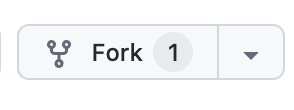
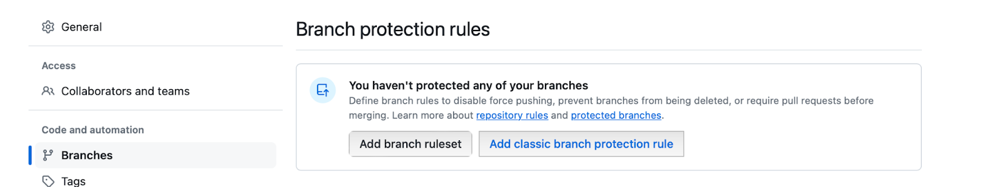
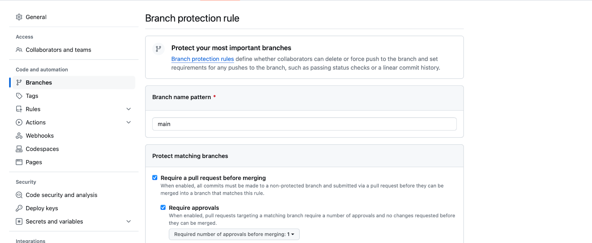
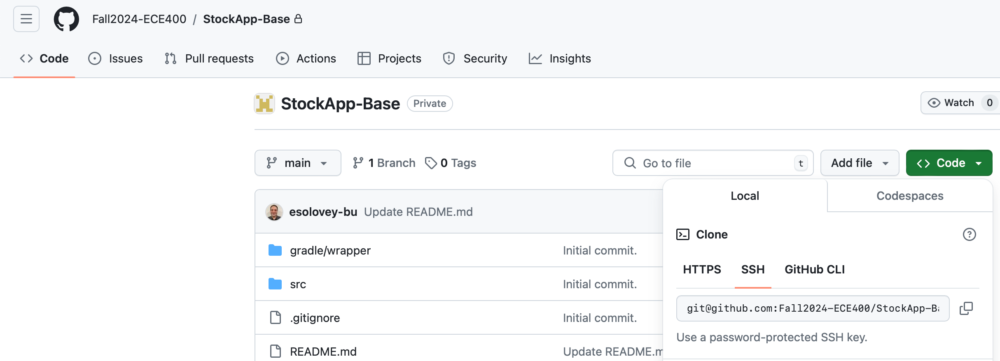
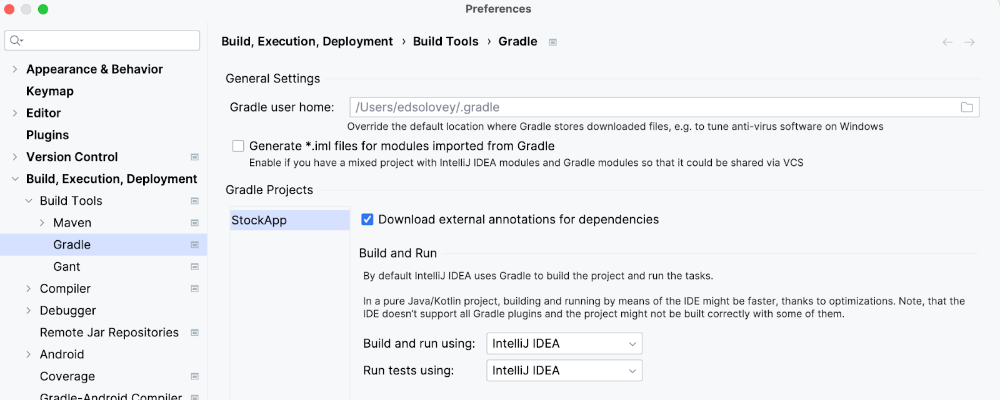
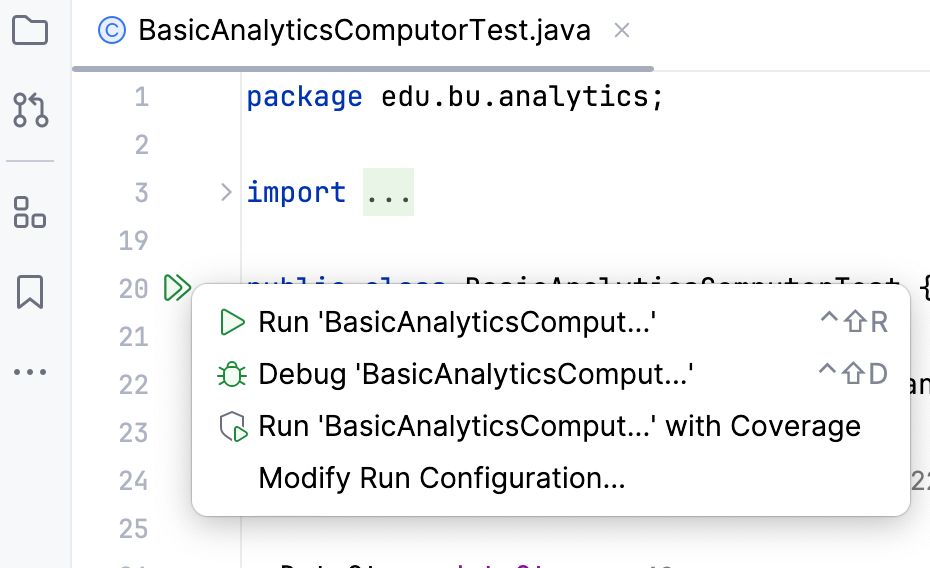
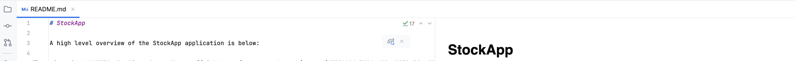
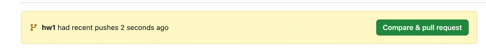
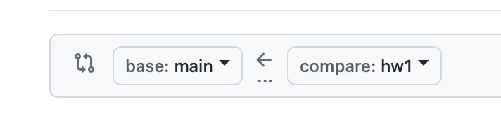

# HW1 — Environment Setup

**Posted:** Wednesday, September 2 · **Due:** Sunday, September 6 at 11:59 PM

Welcome to EC427! The goal of this assignment is to get you set up for the mechanics and logistics of every other assignment in this class. Specifically, we want to make sure that you:

1. are set up with your own GitHub repository that you will use for the duration of this class
2. have initialized that repository by forking the base repository set up for this purpose — a shared starting point for everyone
3. can pull code down from GitHub to the environment where you will be working, either your own machine or an ECE lab machine
4. can build the starting repository in your local environment
5. can push changes back to your GitHub repository
6. can create Pull Requests against your GitHub repository

This assignment involves no code changes beyond a one-line edit to a file, which proves out every step above. **This is a binary assignment** — complete the setup by the deadline and you receive all 100 points.

> **No oral examination for this assignment.** HW1 is the one exception in this class: there is no code here to have a conversation about, so your grade is just the 100 points. Every assignment from HW2 onward includes a 10 minute oral examination, and your submission score is multiplied by how well it goes — see the [syllabus](../../SYLLABUS.md#oral-examination) for how that works. Use this first week to get your environment genuinely solid.

## Submitting assignments

Throughout this class you will manage your own fork of the [BU-EC427-Fall2026/assignments](https://github.com/BU-EC427-Fall2026/assignments) repository. We will refer to your fork as `BU-EC427-Fall2026/<last-name>-<first-name>-StockApp`. You will create your fork inside the `BU-EC427-Fall2026` organization and name it that way. No students other than you will have access to your fork.

The process for submitting homework is the same every week. Don't worry if these steps sound unfamiliar — walking you through each one is the whole point of this assignment.

1. Make code changes locally.
2. Create a git branch whose name matches the homework assignment, e.g. `hw1`.
3. Commit your changes to that branch.
4. Push that branch to your forked repository.
5. Create a Pull Request asking that your branch be merged into your fork's `main`, and answer that assignment's open-ended questions in the Pull Request description.
6. Invite the `staff` team as a reviewer of that Pull Request.
7. We give you feedback on the Pull Request, and you eventually merge it into the `main` branch of your own repository. **You will never merge anything back to the base repository.**

Submitting via Pull Request has some real benefits:

1. It introduces you to the code evolution and review process used across virtually all of industry.
2. It lets the staff give you feedback in exactly the form you will receive it on the job.
3. You can open the Pull Request before your work is finished and keep pushing to it. Grading does not start until the deadline.

As always, be collaborative about any problems you hit during setup — ask questions early and often in the `#hw1` channel of our class Slack workspace.

## Step 1 — Create a GitHub account and get invited to the base repo

If you already have a github.com account you are welcome to use it. Otherwise go to [github.com](https://github.com), click **Sign Up**, and follow the prompts.

Once you have an account, submit your username through the form linked on Blackboard so we can invite you to the organization and let you create your fork.

## Step 2 — Fork the base repository

For the duration of the class you will maintain your own private fork of the base repository. A fork is a copy of an existing repository that lets you make changes without affecting the original. As we cover more material in class, your individual fork will evolve to follow along.

> **Important:** you should only ever commit code to, and create branches against, **your own fork**. You should never need to commit anything to the base repository. Keep this in mind when you create Pull Requests — the base of the pull request (the merge target) should always be your own fork, never `BU-EC427-Fall2026/assignments`.

> Collaboration with classmates is encouraged, but your fork holds your homework submissions. Do not grant any other student access to it.

Once your GitHub user is set up and you have accepted the invitation to the organization:

1. Navigate to [BU-EC427-Fall2026/assignments](https://github.com/BU-EC427-Fall2026/assignments).
2. Click **Fork** in the top right.

   

3. Under **Owner**, select the class organization, `BU-EC427-Fall2026`.
4. Name your fork `<last-name>-<first-name>-StockApp` so it is clearly distinguishable from the base repo. Leave **Copy the main branch only** checked. The full path to your fork should look like `BU-EC427-Fall2026/<last-name>-<first-name>-StockApp`.
5. Click **Create fork**.

### Require Pull Requests

Next we will make sure that all code reaching your `main` branch arrives through a Pull Request rather than a direct commit. We will discuss why in detail later in the class.

Go to **Settings → Branches**:



Click **Add classic branch protection rule** and set:

- **Branch name pattern:** `main`
- **Require a pull request before merging:** checked
  - **Require approvals:** checked
  - **Required number of approvals before merging:** 1
- **Do not allow bypassing the above settings:** checked



Click **Create** to save the rule.

### Turn on GitHub Actions

Your fork came with a Continuous Integration pipeline already configured, at `.github/workflows/ci.yml`. It builds the project, runs the tests, and runs static analysis every time you push or open a Pull Request — so you find out that something is broken from a red X on your Pull Request rather than from us. We will cover what it is doing, and extend it, later in the semester.

GitHub disables workflows on newly created forks by default, so you have to switch it on once:

1. Go to the **Actions** tab of your fork.
2. You will see a notice explaining that workflows are not running.
3. Click **I understand my workflows, go ahead and enable them.**

You will see your first run appear the first time you push a branch in Step 7. If you skip this step, nothing breaks — you just will not get any feedback on your Pull Requests, which makes later assignments considerably harder than they need to be.

### Invite the staff to your new repository

So that we can participate in your code reviews:

1. Go to **Settings**.
2. Go to **Collaborators and teams**.
3. Click **Add teams**.
4. Type `staff`.
5. Add us with the **Read** role.

Your fork is all set. Its URL should look like `https://github.com/BU-EC427-Fall2026/<last-name>-<first-name>-StockApp`, and every homework submission for this class goes against this repository and this repository only.

## Step 3 — Clone your fork

If you do not have the git command line installed, follow [these instructions](https://git-scm.com/book/en/v2/Getting-Started-Installing-Git). You can just run `git` to see whether you already have it.

Your fork exists on GitHub, but you need the code on your local machine to work on it.

1. Create an SSH key on your local machine by following [GitHub's instructions](https://docs.github.com/en/authentication/connecting-to-github-with-ssh/generating-a-new-ssh-key-and-adding-it-to-the-ssh-agent#generating-a-new-ssh-key).
2. You should see output along the lines of `Your public key has been saved in…`.
3. On github.com, go to **Settings → SSH and GPG keys** for your GitHub user.
4. Click **New SSH key**.
5. Give it a title, then paste in the contents of the public key file from step 2 (e.g. `~/.ssh/id_ed25519.pub`).
6. From your machine, run the clone command below.

```bash
git clone git@github.com:BU-EC427-Fall2026/<last-name>-<first-name>-StockApp.git
```

**Reminder:** make sure the repository you are cloning is your own fork, not the base repo for the class. You can always get the right clone target from your repository's homepage in a browser: click **Code**, select **SSH**, and copy the string listed there.

> **Clone it — do not use "Download ZIP."** That option sits right next to the clone URL and it will not work for this class. A downloaded ZIP is not a git repository, so you cannot commit, branch, or push from it, and our build will fail outright because part of our static analysis compares your changes against `main`. If you see an error mentioning `Cannot find git repository`, this is why.



## Step 4 — Build the project

There is nothing to install for this step. That is deliberate, and it is worth understanding why.

This project is built with [Gradle](https://gradle.org/), a widely used build system for Java. But you will never run a copy of Gradle that you installed yourself — you will run the **Gradle wrapper**, `gradlew`, which is committed into the repository. The wrapper is a tiny script that downloads the exact version of Gradle this project needs, and `build.gradle` pins the exact version of Java, which Gradle also downloads if you do not already have it.

The result is that your build, your classmate's build, the lab machine's build, and our CI pipeline's build are all byte-for-byte the same. In industry this matters enormously: "works on my machine" is one of the most expensive sentences in software engineering, and pinning your toolchain is how teams stop saying it. We will come back to this idea when we cover Continuous Integration.

So: **do not install Java, and do not install Gradle.** If you already have them, that is fine — the wrapper ignores them.

### 4.1 Run the build

Navigate to the directory where you cloned your fork. Its contents should look something like:

```
>> ls
README.md    SYLLABUS.md    assets    build.gradle    gradle    gradlew
gradlew.bat    hw    images    pmdruleset.xml    serviceTest.sh
settings.gradle    src
```

Now run the build. **On macOS or Linux:**

```bash
./gradlew clean build
```

**On Windows** (Command Prompt or PowerShell):

```
gradlew.bat clean build
```

The first run takes a couple of minutes — it is downloading Gradle, and possibly a Java toolchain, and caching both. Every run after that is fast. You will see a lot of output, ending in something like:

```
BUILD SUCCESSFUL in 2s
14 actionable tasks: 13 executed, 1 up-to-date
```

You should also see 26 tests pass along the way. Most of them do not yet do anything very useful — that is where your work starts next week.

If your build fails, or if the first run seems to hang, ask in Slack. Include the full output; a build failure is almost always readable if you scroll up to the first error rather than the last line.

> **A note on the `./` in `./gradlew`.** On macOS and Linux that prefix means "the gradlew in this directory," as opposed to some program named `gradlew` that happens to be on your system PATH. Leave it off and your shell will tell you `command not found`. Windows does not need it.

## Step 5 — Set up IntelliJ

You will want to write your code in the IntelliJ IDE. The Community Edition is available in the ECE lab (PHO 305) or as a [download](https://www.jetbrains.com/idea/download/) — make sure you get the free Community Edition, the second one listed on the page.

Click **Open** and navigate to the directory where you cloned your fork — the directory containing `build.gradle`. IntelliJ will index the project, recognize that it builds with Gradle, and you are ready to go.

One default setting is worth changing to make test execution smoother. Go to **Preferences** (**Settings** on Windows), then **Build, Execution, Deployment → Build Tools → Gradle**. In the **Build and run** section, choose **IntelliJ IDEA** for both dropdowns:



Now confirm you can run a test. Open `BasicAnalyticsComputorTest` and click the green arrow in the gutter to the left of the class name:



Every test case should pass. Most of them do not do much useful yet — this is where you will do most of your work in the next assignment.

### Code formatting

Later in the class we will talk about the benefits of keeping a codebase consistently formatted, rather than having different files formatted differently by different contributors. For now, just be aware that you can run:

```bash
./gradlew spotlessApply    # gradlew.bat spotlessApply on Windows
```

to reformat every file in the project according to our configured standard. The `./gradlew preCommit` target includes `spotlessApply` as well.

To format files from inside IntelliJ you have a few options:

1. Use the Gradle tool window to run targets exactly as you would from the command line.
2. Install the [Spotless Applier](https://plugins.jetbrains.com/plugin/22455-spotless-applier) plugin for a **Code → Reformat Project With Spotless** option.
3. Install the same plugin, then go to **Tools → Actions on Save** and check **Run spotless**.

## Step 6 — Update the README to include your name

Every later assignment requires non-trivial code changes. This one requires a single line.

README files are how repositories give an overview of their contents right on the landing page. Read through [our README](https://github.com/BU-EC427-Fall2026/assignments/blob/main/README.md) and play with the gradle targets documented there — a good way to start understanding what StockApp already does and how the code is organized.

In IntelliJ, open `README.md` at the base of your project. The **Editor and Preview** option in the upper-right corner gives you a side-by-side markdown editor:



Edit the first line to read:

```markdown
# <Your Name> - StockApp
```

and save the file.

## Step 7 — Commit and push your change

A Pull Request is a request to merge code into the main branch of a repository. Throughout this class you will build up your fork by repeating this cycle:

1. Create a Pull Request.
2. Have a conversation inside that Pull Request with a staff reviewer, ending in an approval.
3. Merge your Pull Request into `main`.

You do not have to finish the whole assignment before opening a Pull Request. Open it early and keep adding to it.

Start by creating a local branch:

```bash
git branch hw1        # hw1 is the branch name
git checkout hw1      # make the new branch active
```

Make your change from Step 6, then check what you have modified:

```bash
git status            # should show just the README file
```

When you are ready for a checkpoint, commit:

```bash
git commit -a -m "updated README to include name"
```

Here `-m` supplies your commit message, and `-a` automatically stages every **already-tracked** file you have modified or deleted. Note that `-a` does *not* pick up brand-new files that git has never seen — for those you need `git add <file>` first. That distinction will matter in later assignments, when you start adding new classes.

Then push the branch so GitHub knows about it. Until now it existed only on your machine:

```bash
git push --set-upstream origin hw1
```

## Step 8 — Open a Pull Request to submit your assignment

Navigate to your fork on GitHub. You should see a banner like this:



Click **Compare & pull request**.

> **Important:** make sure the base of the Pull Request is **your fork**, not the base repository for the class. The top of your Pull Request should look like this:



Give your Pull Request a title — "HW1 assignment" is fine.

In general you will answer each assignment's open-ended questions in the Pull Request description, using the template below. For this assignment, all you need to include is a screenshot of your `./gradlew clean build` output from Step 4.1 showing the build succeeding.

Under **Reviewers**, invite `BU-EC427-Fall2026/staff`. Then click **Create pull request**.

That's it — you are ready to iterate on code for this class and submit it via Pull Requests.

If you would prefer a git GUI client over the command line for any of the steps above, two good ones are [GitHub Desktop](https://github.com/apps/desktop) and [SourceTree](https://www.sourcetreeapp.com/).

## Pull Request template for this assignment

Every assignment ends with a section like this — a template for your Pull Request description, where you answer that assignment's open-ended questions. There is not much to answer this week, but it is a good habit to start.

```markdown
## Step 4 - Build the project

Paste your `./gradlew clean build` output below:
```
