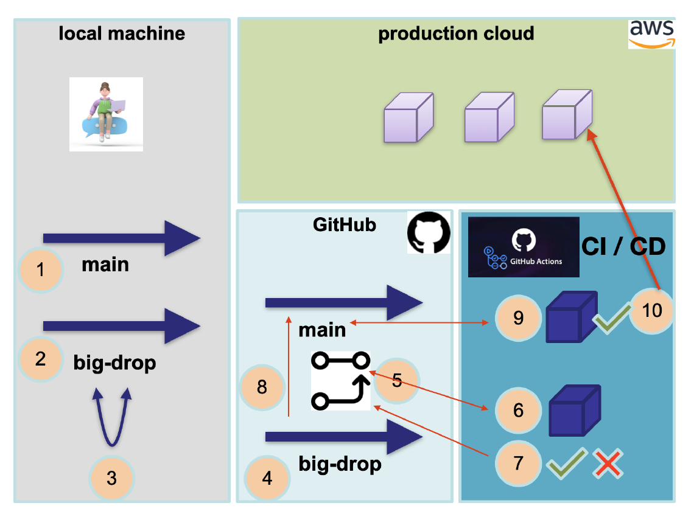

# HW4 — Continuous Integration & Good Code

**Posted:** Monday, September 28 · **Due:** Sunday, October 4 at 11:59 PM

In this assignment you will complete the Continuous Integration Pipeline for your StockApp fork via GitHub Actions. This will be surprisingly straightforward to set up and will provide immense benefits to your repository for the rest of this class.

You will then apply your skills around writing self-documenting, modular, good code by implementing a new end-to-end StockApp endpoint.

Finally, you'll exercise your code organization, collaboration, and design principles by introducing a caching layer for one of our StockApp HTTP requests.

> **NOTE:** for this assignment you will be creating **multiple Pull Requests**:
>
> 1. one from branch `hw4_1` to extend your Continuous Integration Pipeline — you will **merge** this one into your fork's `main` once it passes
> 2. one from branch `hw4_2` for Problem 1.3, to demonstrate how your Continuous Integration Pipeline flags problematic branches and blocks them from being merged — this one is **never merged**
> 3. finally, one from branch `hw4` with the implementation and answers to the questions for Problems 2 and 3 — **this is your graded submission**, so per the [syllabus](../../SYLLABUS.md#homework-assignments-55) the branch must be named exactly `hw4`

Parts of this assignment ask you to explain things in writing. Answer those as part of the description of your `hw4` Pull Request. **A detailed template specific to this assignment is included at the very end.**

> **Oral examination:** this assignment includes a 10 minute oral examination about your work, and your submission score is multiplied by how well it goes. The full question bank and rubric are at the end of this document — read them before you sign up for a slot.

Good luck! And please ask any questions in our Slack **#hw4** room.

## Getting Ready Best Practice

Same as always — start from a clean, current `main` and branch from there:

1. `git fetch`
2. `git checkout main`
3. `git pull`
4. `./gradlew clean build` — confirm latest `main` builds for you

Then create your branch (starting with `hw4_1` for Problem 1):

1. `git branch hw4_1`
2. `git checkout hw4_1`

Commit incremental progress with `git commit -a -m "description of incremental progress"`.

## Problem 1 — Continuous Integration Configuration (20 points)

In class we went over the 10 step flow around getting a code change from a local machine all the way to a production environment where it serves customer traffic.



Full automation of this flow would not be possible without a Continuous Integration Server to help us easily

1. execute tests and static analysis against our shared `main`,
2. execute tests and static analysis against our Pull Request branches and block merges for failing branches/PRs
3. eventually deploy our code to production

We will cover (3) later in this class, but for this problem you are going to set your repository up for (1) and (2) and confirm that things are behaving as expected!

### 1.1 — Complete your Continuous Integration Pipeline (10 points)

Your repository has been carrying a starter pipeline all semester: `.github/workflows/ci.yml`. Every push to `main` and every Pull Request already compiles the project, runs the unit tests, and runs static analysis — the same `./gradlew clean build` you run locally. Open the file and read the comments before going further; it ends with a promise that "You will extend this pipeline in a later assignment." That assignment is this one.

> **Checkpoint before you start:** GitHub disables workflows on forks until the fork owner enables them. Go to the **Actions** tab of your fork — if you see a button asking you to enable workflows, click it. If you can see runs of **CI Pipeline** from your earlier PRs, you are already set.

Create a new branch, `hw4_1`, and extend `.github/workflows/ci.yml` in three ways:

1. **Publish the unit test results to your PRs.** After the existing *Build, test, and analyze* step, add a step that posts a comment on your Pull Request summarizing the unit test run.
2. **Run the service test.** Your repository root contains `serviceTest.sh` — it starts the real server against the mock Finhub client and runs `ServerIntegrationTest` against it over actual HTTP. Add a step that executes it.
3. **Publish the service test results to your PRs** the same way as the unit test results.

There is one catch before you wire in the service test. A CI step passes or fails based on one thing only: the **exit code** of the command it runs — zero is success, anything else fails the step. Now look at the last line of `serviceTest.sh`: it ends with `exit 0`, unconditionally. Run locally that is harmless, because you are watching the output. Run in CI, it means the *Service test* step would stay green even when `ServerIntegrationTest` fails.

**Fix the script as part of this problem.** Capture the exit code of `./gradlew executeServerIntegrationTest` immediately after it runs — the shell puts the previous command's exit code in `$?`, and the very next command overwrites it — let the cleanup at the bottom of the script still run, and `exit` with the captured code instead of `0`. Think about why the cleanup has to run whether the test passed or failed; that is exactly why the script cannot just crash out on the first error.

Here is what the finished file should look like — the *new* material is the `checks`/`pull-requests` permissions and the last three steps:

```yaml
name: CI Pipeline

on:
  push:
    branches: [ "main" ]
  pull_request:
    branches: [ "main" ]

# If you push twice in quick succession, cancel the older run rather than paying for both.
concurrency:
  group: ci-${{ github.ref }}
  cancel-in-progress: true

jobs:
  build:
    name: CI Pipeline
    runs-on: ubuntu-latest

    permissions:
      contents: read
      # The publish steps below create check runs and comment on your PRs,
      # which the default read-only token is not allowed to do.
      checks: write
      pull-requests: write

    steps:
      - uses: actions/checkout@v4
        with:
          # Full history, not just the latest commit. Our static analysis compares your
          # changes against main, so it needs to be able to see main.
          fetch-depth: 0

      # Installs a JDK to run Gradle itself and caches the Gradle distribution and
      # dependencies between runs. The Java version our code compiles against is pinned
      # in build.gradle, independently of this.
      - name: Set up JDK 21
        uses: actions/setup-java@v4
        with:
          java-version: '21'
          distribution: 'temurin'
          cache: 'gradle'

      - name: Build, test, and analyze
        run: ./gradlew clean build

      # Keeps the test XML around so you can inspect failures from the run summary
      # instead of scrolling the log.
      - name: Upload test results
        if: always()
        uses: actions/upload-artifact@v4
        with:
          name: test-results
          path: build/test-results/
          retention-days: 14
          if-no-files-found: ignore

      - name: Publish unit test results
        if: always()
        uses: EnricoMi/publish-unit-test-result-action@v2
        with:
          files: |
            **/build/test-results/test/*.xml

      - name: Service test
        if: success()
        timeout-minutes: 2
        run: |
          chmod +x ./serviceTest.sh
          ./serviceTest.sh

      - name: Publish service test results
        if: always()
        uses: EnricoMi/publish-unit-test-result-action@v2
        with:
          files: |
            **/build/test-results/executeServerIntegrationTest/*.xml
          check_name: Service Test Results
          comment_mode: always
```

The most relevant sections are:

1. **Build, test, and analyze** — builds the project and executes unit tests (already there)
2. **Publish unit test results** — adds a comment with a unit test summary to your PRs
3. **Service test** — executes the service test
4. **Publish service test results** — adds a comment with a service test summary to your PRs

Notice that the two publish steps use `EnricoMi/publish-unit-test-result-action` — the **first third-party action** in your pipeline. Every step so far has used actions published by GitHub itself (`actions/*`); this one is code written by someone on the internet, running with write access to checks and comments in your repository. The starter `ci.yml` told you this moment was coming. We talked about supply-chain trust in lecture — be ready to talk about it in the oral examination.

Push the branch, create a Pull Request against **your fork's** `main`, and add **staff** as reviewers as usual. Watch the workflow run on the PR — you should see the run itself under the Actions tab, and then two comments appear on your PR with test summaries. Once everything is green, **merge this PR** so every future branch gets the full pipeline.

### 1.2 — Configure GitHub to require that tests pass before PRs can be merged (5 points)

We want GitHub to prevent PRs with failing unit or service tests from being merged into `main`.

In your fork on GitHub, go to **Settings → Branches → Branch protection rules**.

- If you already have a rule for `main`, click **Edit** next to it.
- If you do not have one yet, click **Add branch protection rule** and enter `main` as the branch name pattern.

Select the checkbox next to **Require status checks to pass before merging**. In the search box below it you should see the workflow job you just ran, **CI Pipeline** — select it and save the rule. (A check only appears in that list after it has run at least once, which is why 1.1 comes first.)

### 1.3 — Create a PR with a problem to prove out CI integration checks (5 points)

Create a new branch, `hw4_2`, and make a test fail on that branch (any test is fine — we won't ever merge this branch). Push this branch and create a PR. You should see a message from your GitHub workflow noting that a check has failed and this branch cannot be merged until it is resolved. Add **staff** as reviewers so we can confirm this set up. For this problem, we will leave this branch as is, but in practice you would push a fix to the problem, GitHub Actions would re-run and, if all went well, update the message with a green checkmark unblocking the merge.

## Problem 2 — Implementing a new end-to-end API (30 points)

Do this work, and Problem 3's, on a new branch named exactly `hw4`, branched from your `main` **after** merging your Problem 1.1 PR — that way your new pipeline runs against everything you submit.

For this problem we are going to implement a new API not just in `BasicAnalyticsComputor` but end-to-end through the web server so our users can invoke it.

The API we will be implementing is **averageVolumePerSecond**. Here is the goal for this API:

For a given stock symbol, compute the average volume per second over all data points that our server has seen for that symbol. If the server has only seen one data point, or multiple data points all at the same instant, this API should use a single second as the elapsed interval. Note that this API is not concerned with the price of the stock.

Valid stock symbols are between 1 and 5 alphanumeric characters. No special characters are allowed. In no case should your API throw an exception. If the request is missing the stock symbol parameter, if the parameter is not a valid stock symbol, or if your server has no information about the requested symbol, the API should return an informative String error.

For example, if we have seen the following data points for "NVDA":

```json
{
  "data":
  [
    {"s":"NVDA", "p":90.18, "t":1722470400000, "v":300},
    {"s":"NVDA", "p":80.18, "t":1722470600000, "v":100},
    {"s":"NVDA", "p":85.18, "t":1722470800000, "v":400}
  ],
  "type":"trade"
}
```

The range of data we have is (1722470800000 ms - 1722470400000 ms) = 400000 ms = 400 seconds. And the total volume that we have seen over that time is 800. So our API should return 2.0 and if our server receives the following request:

```
curl "http://localhost:8000/averagevolume/NVDA"
```

it should return 2.0.

As another example, if we have only seen the following data point:

```json
{
  "data":
  [
    {"s":"NVDA", "p":90.18, "t":1722470400000, "v":300}
  ],
  "type":"trade"
}
```

The API states that since we don't have a full time range (just a single data point), we should assume that only one second has elapsed and return 300 for this call.

### 2.1 — Implementation + Testing (20 points)

You can explore the code base and find all of the pieces needed to implement this new API based on how other, existing APIs are already implemented. For example, trace how the **price** API is implemented to get an idea of where you need to add code.

As you work on the implementation, please keep the following ideas that we covered in lecture in mind:

- If any of your new methods are longer than 15 lines think about breaking them up into smaller methods
- make sure all your new variable and method names help make the code self-documenting
- make sure that all your new code maintains the **single responsibility principle**. Does adding a piece of new code to an existing class now make that class do multiple, totally different things?
- think about modularity, for example our API takes a stock symbol parameter...
  - what class is responsible for making sure one is passed in and short-circuiting processing if it is not?
  - what class is responsible for making sure the passed in symbol is feasible as a valid stock symbol — one through five alphanumerics and no special characters — and short circuiting processing if it is not?
  - what class is responsible for making sure we have data for the requested stock symbol and returning a response indicating otherwise if we do not?

Make sure that you include unit test updates for your new code changes and that any new static analysis warnings get addressed.

### 2.2 — Code Design/Style Questions (10 points)

**In your PR**, answer the following questions:

1. How did you discover/decide what files you changed and what new files you introduced?
2. How did you decide where to implement the various types of error handling for this new API?
3. Did static analysis catch any issues that you had to go back and fix?

## Problem 3 — Introducing a Response Cache (50 points)

You can imagine that with our current implementation as our server sees more and more data, many of the `BasicAnalyticsComputor` computations will get slower and slower. Let's focus on `totalObservedVolume`. It scans every data point that we have seen for a given stock to come up with a total sum of observed volume. So it has an O(n) read running time, which can be significant as **n** grows larger and larger. We'll consider other ways of reducing this running time later in the class, but for this problem we are going to reduce it by introducing a cache — just for this single API.

A cache is a temporary storage area that holds frequently accessed data to speed up subsequent access to that data. By storing copies of the data closer to where it's needed (e.g. in memory instead of on disk), or in front of an expensive computation that would produce the same value if performed again, a cache reduces the time it takes to retrieve that data.

The two biggest challenges with caches is knowing when to invalidate them and the mechanics around invalidation. That is, how do we know that the temporary value that we are holding needs to be discarded in favor of performing the original computation again?

We are going to keep invalidation very straightforward to start. Whenever our server sees a new data point from FinHub, we will invalidate the entire cache. Later, we could refine this to be more precise by invalidating just the data points that depend on data for stock-N when we receive an update for that stock.

### 3.1 — Implementation (40 points)

We are going to rely on the **Delegator pattern** that we talked about in class to implement a cache for the `totalObservedVolume` computation. Our new `CachingAnalyticsComputor` will implement `AnalyticsComputor` and delegate to it directly for all methods other than `totalObservedVolume`. For `totalObservedVolume`, it will first check to see if it's possible to use the cache — if it is, use it; if not, delegate to `AnalyticsComputor`, update the cache, and return the value.

Here is the scaffold for your new `CachingAnalyticsComputor` class:

```java
package edu.bu.analytics;

import edu.bu.data.DataStore;
import java.util.HashMap;
import java.util.Map;
import java.util.Set;

public class CachingAnalyticsComputor implements AnalyticsComputor {

  final BasicAnalyticsComputor basicAnalyticsComputor;
  final DataStore dataStore;

  /** Stock symbol keyed hash of total observed volume results. */
  Map<String, Long> totalObservedVolumeCache = new HashMap<>();

  // Leaving the rest for you to implement, but here is an example of how to delegate
  // to a method that is not one that we will be using the cache for:
  @Override
  public Set<String> knownSymbols() {
    return basicAnalyticsComputor.knownSymbols();
  }
}
```

The benefits of using the Delegator pattern here are numerous:

1. because we will have our new `CachingAnalyticsComputor` implement the `AnalyticsComputor` interface, we are going to be able to make a surgical change to our code to introduce its usage — instead of updating a lot of various code points to introduce caching behavior
2. By delegating to `AnalyticsComputor` for the basic computations, `CachingAnalyticsComputor` has a single responsibility — implementing caches — and does not need to concern itself with the computations themselves.
3. This is a nice way to use composition (two distinct classes working together) instead of inheritance (a class that extends and supersedes its parent) — we talked about this in class as well. This pattern makes testing much easier.

Here is what you need to do to complete the implementation of this cache:

1. starting with the code snippet above, complete the implementation of `CachingAnalyticsComputor`
   - Hint: you can use the `numberOfUpdatesSeen` method on `DataStore` to determine whether you need to **clear** your cache.
2. make a single line change in `StockAppServer` to start using the cache. This is the power of this pattern — no other code that interacts with analytics computations had to be modified!
3. Address any static analysis issues that your implementation introduced
4. add the following test to your code base and use it to verify that your implementation is working as expected:

```java
package edu.bu.analytics;

import static org.junit.jupiter.api.Assertions.*;

import com.google.common.collect.ImmutableList;
import edu.bu.data.InMemoryStore;
import edu.bu.finhub.FinhubResponse;
import java.time.Instant;
import java.time.temporal.ChronoUnit;
import java.util.List;
import org.junit.jupiter.api.BeforeEach;
import org.junit.jupiter.api.Test;

class CachingAnalyticsComputorTest {

  static final Instant TEST_TIME = Instant.ofEpochMilli(1722470400000L);

  CachingAnalyticsComputor cachingAnalyticsComputor;
  InMemoryStore dataStore;

  @BeforeEach
  public void setUp() {
    dataStore = new InMemoryStore();
    cachingAnalyticsComputor = new CachingAnalyticsComputor(dataStore);
  }

  @Test
  public void totalObservedVolume_singleCall() throws UnknownSymbolException {
    List<FinhubResponse> singleResponse =
        ImmutableList.of(new FinhubResponse("NVDA", 134.12, TEST_TIME.toEpochMilli(), 100));
    dataStore.update(singleResponse);
    assertEquals(100L, cachingAnalyticsComputor.totalObservedVolume("NVDA"));
  }

  @Test
  public void totalObservedVolume_subsequentCallsWithNoUpdateComeFromCache()
      throws UnknownSymbolException {
    List<FinhubResponse> singleResponse =
        ImmutableList.of(new FinhubResponse("NVDA", 134.12, TEST_TIME.toEpochMilli(), 100));
    dataStore.update(singleResponse);
    assertEquals(100L, cachingAnalyticsComputor.totalObservedVolume("NVDA"));
    // we are going to put a fake, incorrect marker response in the cache to allow us to easily
    // verify that the cache was used and not cleared since last call - it should not have been
    // because there have been no updates
    cachingAnalyticsComputor.totalObservedVolumeCache.put("NVDA", -999L);
    assertEquals(-999L, cachingAnalyticsComputor.totalObservedVolume("NVDA"));
  }

  @Test
  public void totalObservedVolume_cacheClearedOnUpdate() throws UnknownSymbolException {
    List<FinhubResponse> singleResponse =
        ImmutableList.of(new FinhubResponse("NVDA", 134.12, TEST_TIME.toEpochMilli(), 100));
    dataStore.update(singleResponse);
    assertEquals(100L, cachingAnalyticsComputor.totalObservedVolume("NVDA"));
    // we are going to put a fake, incorrect marker response in the cache and then send an update
    // through the data store - this marker value should be dropped and caching computer should
    // have correct result
    cachingAnalyticsComputor.totalObservedVolumeCache.put("NVDA", -999L);
    List<FinhubResponse> secondResponse =
        ImmutableList.of(
            new FinhubResponse(
                "NVDA", 134.12, TEST_TIME.plus(4, ChronoUnit.SECONDS).toEpochMilli(), 18));
    dataStore.update(secondResponse);
    assertEquals(118, cachingAnalyticsComputor.totalObservedVolume("NVDA"));
  }

  @Test
  public void totalObservedVolume_handleNewSymbolRequest_noCacheInvalidations()
      throws UnknownSymbolException {

    List<FinhubResponse> firstResponses =
        ImmutableList.of(
            new FinhubResponse("NVDA", 134.12, TEST_TIME.toEpochMilli(), 100),
            new FinhubResponse("TSLA", 100.00, TEST_TIME.toEpochMilli(), 300));

    dataStore.update(firstResponses);
    // assert that cache is empty
    assertFalse(cachingAnalyticsComputor.totalObservedVolumeCache.containsKey("NVDA"));
    assertFalse(cachingAnalyticsComputor.totalObservedVolumeCache.containsKey("TSLA"));

    assertEquals(100, cachingAnalyticsComputor.totalObservedVolume("NVDA"));
    // cache should now be populated for NVDA
    assertTrue(cachingAnalyticsComputor.totalObservedVolumeCache.containsKey("NVDA"));
    assertFalse(cachingAnalyticsComputor.totalObservedVolumeCache.containsKey("TSLA"));

    assertEquals(300, cachingAnalyticsComputor.totalObservedVolume("TSLA"));
    // cache should now be populated for NVDA and TSLA
    assertTrue(cachingAnalyticsComputor.totalObservedVolumeCache.containsKey("NVDA"));
    assertTrue(cachingAnalyticsComputor.totalObservedVolumeCache.containsKey("TSLA"));

    List<FinhubResponse> secondResponses =
        ImmutableList.of(
            new FinhubResponse("NVDA", 135.12, TEST_TIME.plus(3, ChronoUnit.MINUTES).toEpochMilli(), 90),
            new FinhubResponse("TSLA", 101.00, TEST_TIME.plus(3, ChronoUnit.MINUTES).toEpochMilli(), 230));

    dataStore.update(secondResponses);
    assertEquals(190, cachingAnalyticsComputor.totalObservedVolume("NVDA"));
    // cache should now be populated for NVDA
    assertTrue(cachingAnalyticsComputor.totalObservedVolumeCache.containsKey("NVDA"));
    assertFalse(cachingAnalyticsComputor.totalObservedVolumeCache.containsKey("TSLA"));

    assertEquals(530, cachingAnalyticsComputor.totalObservedVolume("TSLA"));
    // cache should now be populated for NVDA and TSLA
    assertTrue(cachingAnalyticsComputor.totalObservedVolumeCache.containsKey("NVDA"));
    assertTrue(cachingAnalyticsComputor.totalObservedVolumeCache.containsKey("TSLA"));
  }
}
```

### 3.2 — Questions (10 points)

**In your PR**, answer the following questions:

1. Run the above test with code coverage enabled — does it cover 100% of your total observed volume and caching code? Why or why not?
2. Describe in words what changes you would need to make if we wanted to clear the cache more surgically — not the entire cache every time, but just one symbol at a time?

## Submitting this assignment

As with other homework assignments, you are going to submit this by creating Pull Requests against your repository (not the base one!). As a reminder, the steps to do that are:

- Make sure you have pushed all your changes to your local branch via `git commit -a -m "<description>"`. You can double check the state of your local branch by running `git status` to see if there are any outstanding changes.
- Before pushing your branch, it's always a good idea to make sure that your local branch is in a good state. Run `./gradlew preCommit`. It cleans, reformats, compiles, runs static analysis, and executes the unit tests. If it passes, your local branch is in a good state!
- You can then push your branch to the cloud repository with `git push --set-upstream origin hw4` or just `git push` if the branch already exists in the cloud repo.
- Once you have pushed your branch, you are ready to create a Pull Request by navigating to GitHub in a browser and clicking the **Compare & pull request** button there for your new branch.

You should end this assignment with three Pull Requests, and now your own Continuous Integration Pipeline will be commenting on them alongside the staff:

| Branch | Contents | State at deadline |
| --- | --- | --- |
| `hw4_1` | Extended CI pipeline (Problem 1.1) | Merged into your `main` |
| `hw4_2` | Deliberately failing test (Problem 1.3) | Open, blocked by the failing check |
| `hw4` | Problems 2 & 3 + written answers | Open — this is your graded submission |

> **IMPORTANT: make sure the base of each pull request is your fork and not the base for the class.** Throughout this course you only create Pull Requests against, and merge code into, your own repository.

Remember to invite the `staff` team as a reviewer on all three.

### GitHub Pull Request Template for the `hw4` PR

```markdown
## Problem 2 — Implementing a new end-to-end API
### How did you discover/decide what files you changed and what new files you introduced?

Response here

### How did you decide where to implement the various types of error handling for this new API?

Response here

### Did static analysis catch any issues that you had to go back and fix?

Response here

## Problem 3 — Introducing a Response Cache
### Run the above test with code coverage enabled, does it cover 100% of your total observed volume and caching code? Why or why not?

Response here

### Describe in words what changes you would need to make if we wanted to clear the cache more surgically — not the entire cache every time, but just one symbol at a time?

Response here
```

## Oral Examination — Questions and Rubric

A **10 minute conversation** with the TA or the instructor during the week after the deadline, producing a **multiplier between 0.0 and 1.0** applied to your submission score.

Same format as HW2 and HW3. Nothing here is a secret — read it before you sign up.

### What the conversation looks like

You will be asked **three questions**, all anchored in **the code you actually submitted**. We will have your Pull Requests open in front of us.

### How your multiplier is calculated

You start at **1.0**.

- **Answer all three questions well → 1.0.**
- **If you cannot answer a question, we ask a follow-up** — a smaller, more concrete version of the same question. Answer that well and you lose only **0.05** for that part.
- **If you can answer neither the question nor the follow-up, you lose 0.33** for that part.

The multiplier never goes below 0.0.

| What happened | Multiplier |
| --- | --- |
| All three answered well | **1.00** |
| Two answered well, one recovered on the follow-up | **0.95** |
| One answered well, two recovered on follow-ups | **0.90** |
| All three recovered on follow-ups | **0.85** |
| Two answered well, one missed entirely | **0.67** |
| One answered well, one recovered, one missed entirely | **0.62** |
| One answered well, two missed entirely | **0.34** |
| All three missed entirely | **0.00** |

### What "answered well" means

You do not need to be word perfect, and you will not be marked down for pausing to think or re-reading your own code. We are checking that you can explain **your own submission** and reason about it:

- you can navigate your code and describe what it does without guessing
- you can explain *why* you made a choice, not just *what* the code does
- you can reason about a condition the assignment did not ask you to handle

> **A note on AI assistance:** the [AI / LLM Policy](../../SYLLABUS.md#ai--llm-policy) applies to this assignment. The oral examination is where that policy has teeth. If you cannot explain code that appears under your name, the multiplier is where it shows up — regardless of whether the submission passes every automated check.
