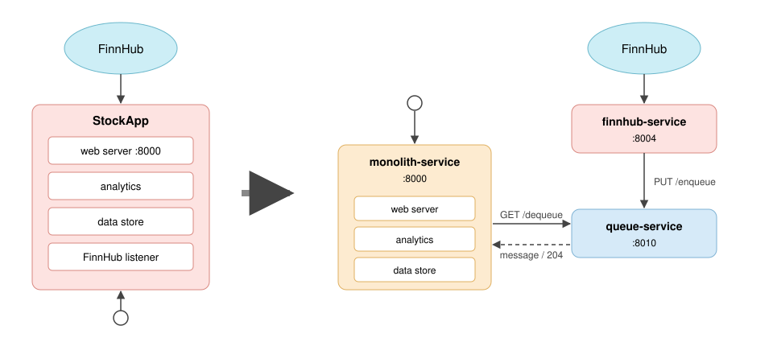

# HW6 — Breaking Up the Monolith, Part 1: Project Re-structure & Queue Service

**Posted:** Monday, October 12 · **Due:** Sunday, October 18 at 11:59 PM

Over the next two assignments you are going to re-factor **StockApp** from a single-process monolith into **microservices**. This week you will lay all of the groundwork: you will re-structure our gradle project so that it can hold multiple modules, pull reusable code out into a **shared library**, and build your first brand-new microservice — an in-memory **queue-service**. Next week, in HW7, you will pull the FinnHub listener out into its own service and wire everything together through the queue you build this week.

Here is where the two assignments are taking us:



By the end of *this* assignment, StockApp itself still runs exactly as it does today — just from inside a module called **monolith-service** — and your new **queue-service** runs as a second, completely independent process that you can talk to with `curl`. Nothing is wired together yet. That is next week.

A note on timing: Problem 1 is deliberately mechanical — you can start it Monday with nothing but this document. Wednesday's lecture covers the *why* behind this architecture and will make Problem 1.3 and Problem 2.3 much easier to answer well.

> **NOTE:** this assignment is a single Pull Request from a branch named exactly `hw6` — per the [syllabus](../../SYLLABUS.md#homework-assignments-55), a PR from a branch with any other name will not be graded.

Parts of this assignment ask you to explain things in writing. Answer those as part of the description of your Pull Request (PR). **A detailed template specific to this assignment is included at the very end.**

> **Oral examination:** this assignment includes a 10 minute oral examination about your work, and your submission score is multiplied by how well it goes. Details at the end of this document.

Good luck! And please ask any questions in our Slack **#hw6** room.

## Getting Ready Best Practice

Same as always — start from a clean, current `main` and branch from there:

1. `git fetch`
2. `git checkout main`
3. `git pull`
4. `./gradlew clean build` — confirm latest `main` builds for you

Then create your branch:

1. `git branch hw6`
2. `git checkout hw6`

Commit incremental progress with `git commit -a -m "description of incremental progress"`.

## Problem 1 — Re-factor the gradle project to be microservices conducive (50 points)

Re-factoring project structure is not at all uncommon. You may start a project without knowing how much it will expand over time, and later find that it is a high-priority project growing really fast. Being comfortable re-structuring a project is a genuinely useful skill.

Currently, our `build.gradle` file is at the very root of our repo and is the only such file in the repo. Similarly, there is only one source folder, `src`, also at the root. We are going to change that in order to make provisions for our microservices.

We are moving to a set-up where there is still a `build.gradle` at the root, but there are now also subfolders for each **module** of our project. Each module will be one of two things:

1. a **shared library module** — code that we reuse across modules but do not directly deploy/run
2. a **microservice module** — code that depends on zero or more of our shared libraries and that we *do* directly deploy/run as a single microservice

Each module will have its own:

- `build.gradle` file with configuration specific to that module
- `src` folder with source code for that specific module

The four modules we are creating are:

- **stock-app-shared** — our first **shared library** module, which is not itself deployable.
- **monolith-service** — a **microservice module**. Initially it will contain everything that we have not pulled out yet, including our customer-facing web server, and will still behave exactly like today's StockApp. We will pull more out of it as we go.
- **finnhub-service** — a **microservice module** whose sole responsibility will be to subscribe to and receive FinnHub updates (or mock them). **It stays empty this week** — we populate it in HW7.
- **queue-service** — a **microservice module** that will act as an async communication channel between `finnhub-service` and whoever consumes FinnHub updates — for now, `monolith-service`. You implement it in Problem 2.

### 1.1 — Folder/Module structure (30 points)

**Step 1 — replace your top-level `build.gradle`** with the version below. It is not too different from the current one — the main change is that all of the common configuration moved into a `subprojects` block, so every module inherits our **pmd**, **spotless**, dependency, and test configuration, and each module gets its own `preCommit` task.

```groovy
plugins {
	id 'com.adarshr.test-logger' version '4.0.0' apply false
	id "com.diffplug.spotless" version "7.0.0.BETA1" apply false
}

// Everything in this block applies to every module (subproject) in the project. Each
// module gets its own build.gradle for configuration specific to that module - like
// its runService task or a dependency on a shared library module.
subprojects {
	apply plugin: 'java'
	apply plugin: 'com.adarshr.test-logger'
	apply plugin: 'pmd'
	apply plugin: 'com.diffplug.spotless'

	group = 'edu.bu'
	version = '1.0-SNAPSHOT'

	java {
		toolchain {
			languageVersion = JavaLanguageVersion.of(21)
		}
	}

	repositories {
		mavenCentral()
	}

	dependencies {
		testImplementation 'org.junit.jupiter:junit-jupiter-api:5.8.1'
		testImplementation 'org.mockito:mockito-core:5.12.0'
		testRuntimeOnly 'org.junit.jupiter:junit-jupiter-engine:5.8.1'
		// Gradle 9 no longer puts the JUnit Platform launcher on the test classpath automatically.
		testRuntimeOnly 'org.junit.platform:junit-platform-launcher:1.8.1'
		implementation 'io.finnhub:kotlin-client:2.0.20'
		// The Finnhub client is written in Kotlin, so its standard library has to be on our
		// runtime classpath. There is no Kotlin source in this project, so we declare the
		// stdlib as an ordinary dependency rather than applying the Kotlin plugin.
		implementation 'org.jetbrains.kotlin:kotlin-stdlib:2.0.21'
		implementation 'org.java-websocket:Java-WebSocket:1.5.6'
		implementation 'com.googlecode.json-simple:json-simple:1.1.1'
		implementation 'com.google.guava:guava:33.2.1-jre'
		pmd 'net.sourceforge.pmd:pmd-ant:7.0.0'
		pmd 'net.sourceforge.pmd:pmd-java:7.0.0'
		implementation 'org.tinylog:tinylog-api:2.6.2'
		implementation 'org.tinylog:tinylog-impl:2.6.2'
	}

	pmd {
		consoleOutput = true
		toolVersion = "7.0.0"

		pmdMain {
			rulesMinimumPriority = 4
			ruleSets = [
					"category/java/performance.xml/AvoidArrayLoops"
			]
		}

		pmdTest {
			rulesMinimumPriority = 1
			ruleSets = [
					"category/java/performance.xml/AvoidArrayLoops",
			]
		}
	}

	spotless {
		// optional: limit format enforcement to just the files changed by this feature branch
		ratchetFrom 'origin/main'

		format 'misc', {
			// define the files to apply `misc` to
			target '*.gradle', '.gitattributes', '.gitignore'

			// define the steps to apply to those files
			trimTrailingWhitespace()
			indentWithTabs() // or spaces. Takes an integer argument if you don't like 4
			endWithNewline()
		}
		java {
			googleJavaFormat()
		}
	}

	test {
		useJUnitPlatform {
			excludeTags "IntegrationTest"
			excludeTags "Probe"
		}

		// Always run tests, even when nothing changed.
		dependsOn 'cleanTest'

		// Show test results.
		testLogging {
			events "passed", "skipped", "failed"
		}
	}

	task preCommit() {
		dependsOn clean, spotlessApply, build
		doLast {
			println 'Pre-commit check Passed!'
		}
	}
}
```

Note that if you added anything of your own to `build.gradle` during previous assignments — PMD rules you enabled, a dependency you added — you need to carry that over into the `subprojects` block.

**Step 2 — tell gradle about the four modules** by adding `include` lines to `settings.gradle` at the root of the repo:

```groovy
include 'stock-app-shared'
include 'monolith-service'
include 'finnhub-service'
include 'queue-service'
```

This file is what lets gradle know what all of the modules in the project are.

**Step 3 — create the module folders.** You can do this from the terminal:

```bash
mkdir -p stock-app-shared/src/main/java stock-app-shared/src/test/java
mkdir -p finnhub-service/src/main/java finnhub-service/src/test/java
mkdir -p queue-service/src/main/java queue-service/src/test/java
```

(You can also create modules from IntelliJ via right-click on the project → **New** → **Module**, but IntelliJ generates its own `build.gradle` boilerplate that you would then need to clean up — the terminal route is more predictable.)

**Step 4 — move all existing code into `monolith-service`.** The entire `src` tree — main, test, and resources (`tinylog.properties` lives there) — moves as-is:

```bash
git mv src monolith-service/src
```

**Step 5 — give each module its own `build.gradle`.**

`monolith-service/build.gradle` — the `runServer*` and `executeServerIntegrationTest` tasks move here from the old top-level file, because the thing they run now lives in this module:

```groovy
// monolith-service: everything that we have not (yet) pulled out into a dedicated service.

task runServer(type: JavaExec) {
	mainClass = 'edu.bu.StockAppServer'
	classpath = sourceSets.main.runtimeClasspath
}

task runServerWithMockFinhub(type: JavaExec) {
	mainClass = 'edu.bu.StockAppServer'
	classpath = sourceSets.main.runtimeClasspath
	args = ["mockFinhub"]
}

// call this with --debug-jvm to have it start and wait for a debugger (IntelliJ) to be attached to it
task runServerWithMockFinhubPreload(type: JavaExec) {
	mainClass = 'edu.bu.StockAppServer'
	classpath = sourceSets.main.runtimeClasspath
	args = ["mockFinhub", "msBetweenCalls=10"]
}

// Unlike the built-in `test` task, a custom Test task is not wired to the test
// source set automatically - without these two lines Gradle finds no tests (NO-SOURCE).
task executeServerIntegrationTest(type: Test) {
	useJUnitPlatform {
		includeTags "IntegrationTest"
	}
	testClassesDirs = sourceSets.test.output.classesDirs
	classpath = sourceSets.test.runtimeClasspath

	// Always run, even when nothing changed since the last invocation.
	outputs.upToDateWhen { false }

	testLogging {
		events "passed", "skipped", "failed"
	}
}
```

`stock-app-shared/build.gradle` and `finnhub-service/build.gradle` need no configuration of their own yet — a comment describing the module is enough:

```groovy
// Shared library module. All common configuration is inherited from the top-level
// build.gradle. This module must not depend on any of our service modules.
```

`queue-service/build.gradle` gets its `runService` task in Problem 2.

**Step 6 — verify.** From the root of the repo:

```bash
./gradlew clean build
```

Even though the root project no longer has any source of its own, gradle runs `clean` and `build` in every module that has those tasks — so this one command still builds and tests everything. Then confirm StockApp still actually runs, now from its module:

```bash
./gradlew monolith-service:runServerWithMockFinhub
```

and in another terminal, `curl -i localhost:8000/symbols` should behave exactly as it did before you started. If both of those work, the re-structure is done.

### 1.2 — Establish the shared module (15 points)

Next, move the code that belongs in our shared, non-deployable module into `stock-app-shared`. We don't have much shared code yet (we will add more later), but these are the classes most likely to be reused across modules:

- **edu.bu.finhub.FinhubParser** — next week, more than one module will care about converting a FinnHub JSON string into a strongly-typed response object
- **edu.bu.finhub.FinhubResponse** — same reasoning
- **your symbol-validation collaborator from HW5** — the class you factored out for HW5's DRY problem (whatever you named it, wherever you put it) — it is likely that we will validate symbols in multiple modules

Move each class to the same package path under `stock-app-shared/src/main/java`, for example:

```bash
mkdir -p stock-app-shared/src/main/java/edu/bu/finhub
git mv monolith-service/src/main/java/edu/bu/finhub/FinhubParser.java stock-app-shared/src/main/java/edu/bu/finhub/
git mv monolith-service/src/main/java/edu/bu/finhub/FinhubResponse.java stock-app-shared/src/main/java/edu/bu/finhub/
```

If any of these classes have unit tests, move those to `stock-app-shared/src/test/java` the same way.

After moving the classes over, does your build fail? Modules that use shared code need to explicitly depend on `stock-app-shared`. Open `monolith-service/build.gradle` and add:

```groovy
dependencies {
	implementation project(':stock-app-shared')
}
```

With that in place, `./gradlew clean build` should pass from the top level again.

FYI: here is the gradle syntax for building a single module rather than everything — `./gradlew monolith-service:build`.

### 1.3 — Shared library vs service (5 points)

**In your PR** (template below): `stock-app-shared` and `queue-service` are both new modules, but one is a shared *library* and the other is a *microservice*. In your own words, what is the difference between reusing code as a library and reusing functionality as a running service? Why is `FinhubParser` a good fit for a library while the queue is a good fit for a service? (Hint: think about which of the two holds state at runtime, and which gets deployed as its own process.)

## Problem 2 — Implement the Queue Service (50 points)

Now that we have the scaffolding for our multi-module project in place, we are ready to implement our first brand-new microservice. Next week we will want `finnhub-service` to hand updates to the rest of our app without the two sides ever talking to each other directly. The mechanism for that will be a dedicated **queue service**.

### 2.1 — /enqueue and /dequeue (35 points)

We are going to start with a very simple implementation of an **in-memory** queue service with a RESTful web interface — the same kind of interface our customer-facing web server is implemented with. Create a class **edu.bu.queue.QueueService** in the `queue-service` module, with a `main` method that initializes and starts the service — much like `StockAppServer` does for the monolith.

Your queue service listens on port **8010** and handles two different HTTP requests:

- **/enqueue** — HTTP **PUT** requests to this endpoint provide a String message in the body of the request. That message should be added to the **tail** of the queue.
- **/dequeue** — HTTP **GET** requests to this endpoint:
  - if there is any data in the queue, should receive a **200** HTTP response with a String representing the message at the **head** of the queue. That message should be removed from the queue as a result.
  - if there is no data in the queue, should receive an HTTP **204** response ([HTTP 204 denotes No Content](https://developer.mozilla.org/en-US/docs/Web/HTTP/Status/204)).

Note what is *not* in this spec: stocks, FinnHub, JSON schemas. `queue-service` stores and returns opaque Strings. Keep it that way — and notice that this means `queue-service` should **not** depend on `stock-app-shared`.

Add a `runService` task to `queue-service/build.gradle`:

```groovy
task runService(type: JavaExec) {
	mainClass = 'edu.bu.queue.QueueService'
	classpath = sourceSets.main.runtimeClasspath
}
```

(`runService`, not `runServer` — this is the naming convention we will use for all of our microservice modules.)

Once you do, you should be able to execute the following from your top-level project:

```bash
./gradlew queue-service:runService
```

and see the service start and listen for requests on port 8010. Once it is running, you should be able to enqueue some test messages with:

```bash
curl -X PUT http://localhost:8010/enqueue -H "Content-Type: application/json" -d '{"name":"Test Message", "value":42}'
```

and then dequeue them with:

```bash
curl -i "http://localhost:8010/dequeue"
```

The dequeue request should come back with:

```
HTTP/1.1 200 OK
Date: Tue, 13 Oct 2026 03:07:45 GMT
Content-length: 37

{"name": "Test Message", "value": 42}
```

when there is data in the queue, and with:

```
HTTP/1.1 204 No Content
Date: Tue, 13 Oct 2026 03:07:50 GMT
```

when there is no data in the queue. Make sure messages come back in **FIFO** order — enqueue two different messages, then dequeue twice and confirm the order.

**Hints:**

- take a look at `java.util.concurrent.ConcurrentLinkedQueue` as a potential in-memory queue implementation to use in your service. Next week this queue will be written to and read from as a result of concurrent requests from *two different services* — think about why that makes the choice of a thread-safe collection important.
- you can use the code snippet below to ensure that requests to **enqueue** are **PUT** and to parse out the body of the request:

```java
// Check if the request method is PUT
if ("PUT".equalsIgnoreCase(exchange.getRequestMethod())) {
    // Read the request body
    String requestBody = new String(exchange.getRequestBody().readAllBytes(), StandardCharsets.UTF_8);
```

- add some `Logger.info` calls so you can watch messages arrive and leave — next week, when three services are running at once, you will be very glad this service narrates what it is doing.

### 2.2 — Unit tests and static analysis (10 points)

Make sure that you add unit test coverage for any non-trivial code changes that you are making, and that all static analysis warnings in your new code are addressed. Design for testability: the queueing logic (add to tail, remove from head, empty behavior) can be tested without starting an HTTP server — think about how to structure your class(es) so that is true. `./gradlew preCommit` must pass from the top level.

### 2.3 — The value of ignorance (5 points)

**In your PR** (template below): your `queue-service` knows nothing about stocks, FinnHub, or the rest of StockApp — it moves opaque Strings. Why is that ignorance valuable? What does it make possible for this service in the future?

## Submitting this assignment

Same as previous assignments. Make sure everything is committed with `git commit -a -m "<description>"`, and check `git status` for anything outstanding.

Before pushing, run `./gradlew preCommit`. It cleans, reformats, compiles, runs static analysis, and executes the unit tests — now across every module. If it passes, your branch is in good shape.

Push with `git push --set-upstream origin hw6`, or just `git push` if the branch already exists remotely.

Then create a Pull Request from GitHub by clicking **Compare & pull request** for your new branch.

> **IMPORTANT: make sure the base of the pull request is your fork and not the base for the class.** Throughout this course you only create Pull Requests against, and merge code into, your own repository.

Remember to invite the `staff` team as a reviewer.

### GitHub Pull Request Template for this Assignment

```markdown
## Problem 1 — Project Re-structure
### Problem 1.3 — What is the difference between reusing code as a library and reusing functionality as a running service? Why is FinhubParser a good fit for a library while the queue is a good fit for a service?

Response here

## Problem 2 — Queue Service
### Problem 2.3 — Your queue-service knows nothing about stocks, FinnHub, or the rest of StockApp. Why is that ignorance valuable? What does it make possible for this service in the future?

Response here
```

## Oral Examination

A **10 minute conversation** with the TA or the instructor during the week after the deadline, producing a **multiplier between 0.0 and 1.0** applied to your submission score.

Same format as the previous assignments, with one change: starting with this assignment there is no published question bank. We will have your Pull Request open in front of us, we will pick **specific lines of your submitted code**, and we will ask you about them — what they do, why you wrote them that way, and what would happen under a condition the assignment did not spell out.

You will be asked **three questions**. There is nothing to study beyond your own submission: if you wrote it and understand it, you are prepared.

### How your multiplier is calculated

You start at **1.0**.

- **Answer all three questions well → 1.0.**
- **If you cannot answer a question, we ask a follow-up** — a smaller, more concrete version of the same question. Answer that well and you lose only **0.05** for that part.
- **If you can answer neither the question nor the follow-up, you lose 0.33** for that part.

The multiplier never goes below 0.0.

| What happened | Multiplier |
| --- | --- |
| All three answered well | **1.00** |
| Two answered well, one recovered on the follow-up | **0.95** |
| One answered well, two recovered on follow-ups | **0.90** |
| All three recovered on follow-ups | **0.85** |
| Two answered well, one missed entirely | **0.67** |
| One answered well, one recovered, one missed entirely | **0.62** |
| One answered well, two missed entirely | **0.34** |
| All three missed entirely | **0.00** |

### What "answered well" means

You do not need to be word perfect, and you will not be marked down for pausing to think or re-reading your own code. We are checking that you can explain **your own submission** and reason about it:

- you can navigate your code and describe what it does without guessing
- you can explain *why* you made a choice, not just *what* the code does
- you can reason about a condition the assignment did not ask you to handle

> **A note on AI assistance:** the [AI / LLM Policy](../../SYLLABUS.md#ai--llm-policy) applies to this assignment. The oral examination is where that policy has teeth. If you cannot explain code that appears under your name, the multiplier is where it shows up — regardless of whether the submission passes every automated check.
