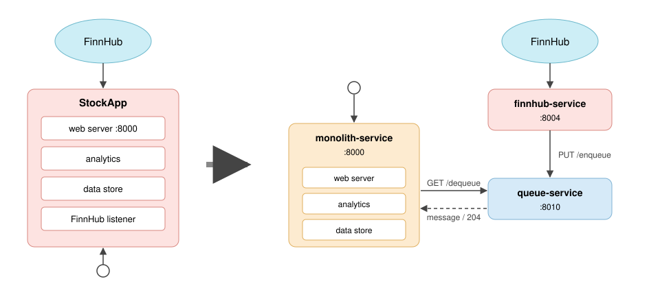

# HW7 — Breaking Up the Monolith, Part 2: Wiring the Services Together

**Posted:** Monday, October 19 · **Due:** Sunday, October 25 at 11:59 PM

Last week you re-structured our project into modules, pulled shared code into **stock-app-shared**, and built a standalone **queue-service**. This week you finish the job: you will extract the FinnHub listener into its own **finnhub-service**, have it publish every update it receives to your queue, and teach the monolith to consume updates from the queue instead of hearing about them directly. By the end of this assignment, StockApp *is* three cooperating microservices:



Notice the shape of the finished system: `finnhub-service` and `monolith-service` never talk to each other. Neither one knows the other exists. All that connects them is the queue — and that indirection is the whole point of this assignment.

> **NOTE:** this assignment is a single Pull Request from a branch named exactly `hw7` — per the [syllabus](../../SYLLABUS.md#homework-assignments-55), a PR from a branch with any other name will not be graded.

Parts of this assignment ask you to explain things in writing. Answer those as part of the description of your Pull Request (PR). **A detailed template specific to this assignment is included at the very end.**

> **Oral examination:** this assignment includes a 10 minute oral examination about your work, and your submission score is multiplied by how well it goes. Details at the end of this document.

Good luck! And please ask any questions in our Slack **#hw7** room.

## Getting Ready Best Practice

Same as always — start from a clean, current `main` (which should now contain your merged HW6 work) and branch from there:

1. `git fetch`
2. `git checkout main`
3. `git pull`
4. `./gradlew clean build` — confirm latest `main` builds for you

Then create your branch:

1. `git branch hw7`
2. `git checkout hw7`

Commit incremental progress with `git commit -a -m "description of incremental progress"`.

## Problem 1 — Finnhub Service (35 points)

With `queue-service` done, we are ready to extract the **finnhub-service**, have it subscribe to FinnHub updates, and enqueue them to our queue. Two things need to happen:

1. We need to move the FinnHub-related classes into this module.
2. We need to update the code that handles FinnHub responses to enqueue them to `queue-service` instead of sending them directly to the `DataStore`.

### 1.1 — Moving code into finnhub-service (15 points)

Start by making `finnhub-service` depend on our shared library. In the `dependencies` section of `finnhub-service/build.gradle` add:

```groovy
dependencies {
	implementation project(':stock-app-shared')
}
```

Then move the following from `monolith-service` into `finnhub-service` (same package paths, under `finnhub-service/src/main/java`):

- `edu.bu.finhub.FinHubWebSocketClient`
- `edu.bu.finhub.MockFinhubClient`
- `edu.bu.finhub.StockUpdatesClient`
- your **subscribe**, **unsubscribe**, and **subscribed-symbols** handlers from HW5 (wherever they live in your code base)
- the unit tests for everything above move to `finnhub-service/src/test/java` the same way

Once you move them, you should start seeing compilation errors, and the errors are the refactor telling you what to do:

- **Remove all references to `DataStore` from finnhub-service.** This service will no longer write to the store — we replace those interaction points with calls to `queue-service` in the next step.
- **Remove the references to `FinhubParser` as well.** These pose an interesting decision: `finnhub-service` *could* parse FinnHub messages here and convert them to a more succinct protocol before passing them along. For now, we will enqueue the raw FinnHub JSON as-is and let the consumer parse it — which is exactly why `FinhubParser` lives in `stock-app-shared`.

Now give the service its entry point. Create **edu.bu.finhub.FinnhubService** with a `main` method that initializes and starts the components of this service, much like `StockAppServer` does for the monolith:

- it chooses the real `FinHubWebSocketClient` or the `MockFinhubClient` based on a `mockFinhub` argument, exactly as `StockAppServer` used to
- it starts a small `HttpServer` (just like the ones we have been using) that listens on port **8004** and handles the **/subscribe**, **/unsubscribe**, and **/subscribed-symbols** requests we implemented in HW5

This means your HW5 endpoints are *moving house*: subscription management is a FinnHub concern, so those three endpoints are now served by `finnhub-service` on port **8004** instead of by the monolith on port 8000. Back in `monolith-service`, clean up what is left behind: `StockAppServer` no longer creates a `StockUpdatesClient`, and `BasicWebServer` no longer needs one as a collaborator. Our monolith is getting smaller — this is great!

### 1.2 — Enqueueing messages to queue-service (20 points)

Now that your `finnhub-service` compiles, it is time to actually enqueue messages to the `queue-service`. We want to do this from both the "real" FinnHub client and the mock one.

A suggestion on how to share the enqueueing code between them: create a class **EnqueueingFinnhubResponseHandler** with a method that takes a String parameter representing a FinnHub JSON response and enqueues that String to our `queue-service` by making an HTTP **PUT** request to `http://localhost:8010/enqueue`. You can then pass this handler to both the real and mock FinnHub clients.

For the real client this is simple — `onMessage` already receives the raw JSON String; hand it to the handler instead of the store.

The mock client takes slightly more thought: it currently builds `FinhubResponse` *objects* directly. Since the queue carries raw FinnHub-format JSON Strings, your mock now needs to produce its canned updates as JSON in the same shape real FinnHub sends — that way the consumer on the other side of the queue cannot tell the difference (which is the entire job of a mock). The shape that `FinhubParser` understands is:

```json
{"type":"trade","data":[{"s":"RIVN","p":18.0,"t":1760000000000,"v":8}]}
```

where `s` is the symbol, `p` the price, `t` the timestamp in ms since epoch, and `v` the volume.

Take a look at the code snippet below to get you started on making an HTTP PUT request in Java:

```java
URL url = new URL("<target URL here>");
HttpURLConnection connection = (HttpURLConnection) url.openConnection();
connection.setRequestMethod("PUT");
connection.setRequestProperty("Content-Type", "application/json");
connection.setDoOutput(true);

OutputStream outputStream = connection.getOutputStream();
byte[] input = <target message here>.getBytes("utf-8");
outputStream.write(input, 0, input.length);

int responseCode = connection.getResponseCode();
```

Finally, the run tasks. The mock-vs-real decision now belongs to `finnhub-service`, so move the three `runServer*` task variants out of `monolith-service/build.gradle` and into `finnhub-service/build.gradle`, renamed to our microservice convention and pointing at your new main class:

- `runService`
- `runServiceWithMockFinhub`
- `runServiceWithMockFinhubPreload`

`monolith-service` keeps a single plain `runServer` task — there is no FinnHub mode left in the monolith to configure.

Once you have them working, you should be able to do the following:

1. in a terminal window run `./gradlew queue-service:runService` to start the queue-service.
2. in a different terminal window run `./gradlew finnhub-service:runServiceWithMockFinhub` (or `./gradlew finnhub-service:runService` with real FinnHub — you'll need to subscribe to at least one symbol via your port-8004 endpoint for updates to flow).
3. if you set up logging in your `queue-service`, you should see it reporting that messages are arriving. If you don't see any logging from `queue-service`, stop it and add some now.
4. in another terminal window, run `curl -i "http://localhost:8010/dequeue"` — you should be able to take some of the messages off the queue and see raw FinnHub-shaped JSON.

## Problem 2 — Monolith Reads From the Queue (40 points)

We are getting really close to restoring full functionality! All that is left is to make `monolith-service` read messages from our `queue-service` and update the `DataStore` as it used to.

### 2.1 — Communication pattern (5 points)

**In your PR** (template below): before you write the code, think about one immediate communication-pattern difference between how the `DataStore` used to find out about a new data point and how it is about to. Who — or what event — originates the communication in the old monolith model, versus in the new model with a queue between FinnHub and the `DataStore`?

### 2.2 — QueueReader implementation (20 points)

Implement a new **QueueReader** class in `monolith-service` that gets started as part of `StockAppServer` initialization and does the following:

- repeatedly asks `queue-service` for new data by making an HTTP GET request to `http://localhost:8010/dequeue`
- when it receives a **200** with a message, parses the raw FinnHub JSON using `FinhubParser` (from `stock-app-shared` — this is the payoff for moving it there last week) and updates the `DataStore` with the result
- gracefully handles the scenario where the queue is empty and it receives a **204** HTTP response instead of a 200 with a message
- rests/sleeps in between HTTP requests, to avoid overwhelming both itself and the `queue-service`

Hints:

- a bare-bones Java HTTP GET request looks something like this:

```java
HttpRequest request = HttpRequest.newBuilder().uri(new URI("<target URL>")).GET().build();
HttpResponse<String> response = httpClient.send(request, HttpResponse.BodyHandlers.ofString());
```

- you will want to start a new thread for your QueueReader — otherwise it will block the rest of `StockAppServer` initialization. One way to run a piece of code in a new thread in Java:

```java
new Thread(
    () -> {
        <your code goes here>
    })
    .start();
```

- to have your thread rest: `Thread.sleep(<rest time in milliseconds>);`

### 2.3 — Exponential back-off (15 points)

The pattern of polling a queue to see if there are new messages is an extremely common, core pattern in distributed systems. And it is common to have different sleep strategies based on whether the most recent request produced a message or a nothing-to-read result.

When a message *was* returned, it makes sense to sleep only briefly — there is likely another message waiting for us.

When *no* message was returned, it is common to sleep a bit longer, to avoid consumers pummeling the queue with requests while it is empty. The most common strategy here is **exponential back-off**: on the first empty result you sleep a little longer than normal; on the second consecutive empty result, longer still (exponentially longer), and so on — up to a limit. You don't want to ever sleep for more than a few minutes, otherwise there will be a large delay in receiving a new message after a quiet period.

Implement a **limited exponential back-off** in your QueueReader for the case where the queue is empty. Your implementation must:

- grow the sleep duration exponentially on consecutive empty results
- cap the sleep duration at a maximum you choose (justify your choice in a comment)
- reset back to the normal short sleep as soon as a message is received

Add unit test coverage for your back-off logic. Hint: that is much easier if the "what should the next sleep duration be?" decision is a pure function, separate from the code that actually sleeps — design for testability.

## Problem 3 — Putting It All Together (25 points)

Now that you have your queue reading implemented, we are ready to try all of the pieces running together!

1. in a terminal window run: `./gradlew queue-service:runService`
2. in a different terminal window run: `./gradlew finnhub-service:runServiceWithMockFinhub`
3. in yet another terminal window run: `./gradlew monolith-service:runServer`
4. in a fourth terminal window, run `curl -i http://localhost:8000/symbols` and `curl -i http://localhost:8000/price/BAC` — you should see the same kinds of responses the monolith produced before this refactor
5. with everything still running, `./gradlew monolith-service:executeServerIntegrationTest` should pass — the same integration test, now exercising three processes instead of one

If all this works, congratulations! You have re-factored a monolith application into three microservices!

### 3.1 — Screenshots (5 points)

Please include screenshots of each of the four terminal windows above showing that things are happening in each. If one of your windows has no action, add a `Logger.info` at an appropriate part of that service to get it to be a little more verbose while running.

### 3.2 — Trade-offs (10 points)

**In your PR:** based on your experience re-factoring your project from a monolith to a multi-module, multi-service set up, as well as your experience testing how the three services interact with each other — what are some of the pros and cons of *developing* applications as monoliths versus microservices? How about *running them in production* as monoliths versus microservices?

### 3.3 — Brand new project (5 points)

**In your PR:** based on this experience as well as our class readings and conversations, if you were to start a new company/project, would you structure your code base as a monolith or microservices at the very beginning? Please explain your answer.

### 3.4 — Monitoring a distributed StockApp (5 points)

**In your PR:** your HW5 monitoring code (`MetricsTracker`, `MetricsWebServer` on port 8001) rode along into `monolith-service` untouched. Does your **updates-volume** metric still mean what it meant before this refactor? If we wanted to monitor the health of *each* of our three services, where should metric collection live — and is a dedicated metrics service the answer? Connect your answer to the application vs infrastructure monitoring distinction from lecture.

## Submitting this assignment

Same as previous assignments. Make sure everything is committed with `git commit -a -m "<description>"`, and check `git status` for anything outstanding.

Before pushing, run `./gradlew preCommit`. It cleans, reformats, compiles, runs static analysis, and executes the unit tests across every module. If it passes, your branch is in good shape.

Push with `git push --set-upstream origin hw7`, or just `git push` if the branch already exists remotely.

Then create a Pull Request from GitHub by clicking **Compare & pull request** for your new branch.

> **IMPORTANT: make sure the base of the pull request is your fork and not the base for the class.** Throughout this course you only create Pull Requests against, and merge code into, your own repository.

Remember to invite the `staff` team as a reviewer.

### GitHub Pull Request Template for this Assignment

```markdown
## Problem 2 — Monolith Reads From the Queue
### Problem 2.1 — Who, or what event, originates the communication in the old monolith model, versus in the new model with a queue between FinnHub and the DataStore?

Response here

## Problem 3 — Putting It All Together
### Problem 3.1 — Screenshots

Screenshots here

### Problem 3.2 — Monolith vs microservices trade-offs, in development and in production

Response here

### Problem 3.3 — Brand new project: monolith or microservices, and why?

Response here

### Problem 3.4 — Does updates-volume still mean what it meant? Where should metric collection live in a three-service StockApp?

Response here
```

## Oral Examination

A **10 minute conversation** with the TA or the instructor during the week after the deadline, producing a **multiplier between 0.0 and 1.0** applied to your submission score.

Same format as HW6: there is no published question bank. We will have your Pull Request open in front of us, we will pick **specific lines of your submitted code**, and we will ask you about them — what they do, why you wrote them that way, and what would happen under a condition the assignment did not spell out.

You will be asked **three questions**. There is nothing to study beyond your own submission: if you wrote it and understand it, you are prepared.

### How your multiplier is calculated

You start at **1.0**.

- **Answer all three questions well → 1.0.**
- **If you cannot answer a question, we ask a follow-up** — a smaller, more concrete version of the same question. Answer that well and you lose only **0.05** for that part.
- **If you can answer neither the question nor the follow-up, you lose 0.33** for that part.

The multiplier never goes below 0.0.

| What happened | Multiplier |
| --- | --- |
| All three answered well | **1.00** |
| Two answered well, one recovered on the follow-up | **0.95** |
| One answered well, two recovered on follow-ups | **0.90** |
| All three recovered on follow-ups | **0.85** |
| Two answered well, one missed entirely | **0.67** |
| One answered well, one recovered, one missed entirely | **0.62** |
| One answered well, two missed entirely | **0.34** |
| All three missed entirely | **0.00** |

### What "answered well" means

You do not need to be word perfect, and you will not be marked down for pausing to think or re-reading your own code. We are checking that you can explain **your own submission** and reason about it:

- you can navigate your code and describe what it does without guessing
- you can explain *why* you made a choice, not just *what* the code does
- you can reason about a condition the assignment did not ask you to handle

> **A note on AI assistance:** the [AI / LLM Policy](../../SYLLABUS.md#ai--llm-policy) applies to this assignment. The oral examination is where that policy has teeth. If you cannot explain code that appears under your name, the multiplier is where it shows up — regardless of whether the submission passes every automated check.
